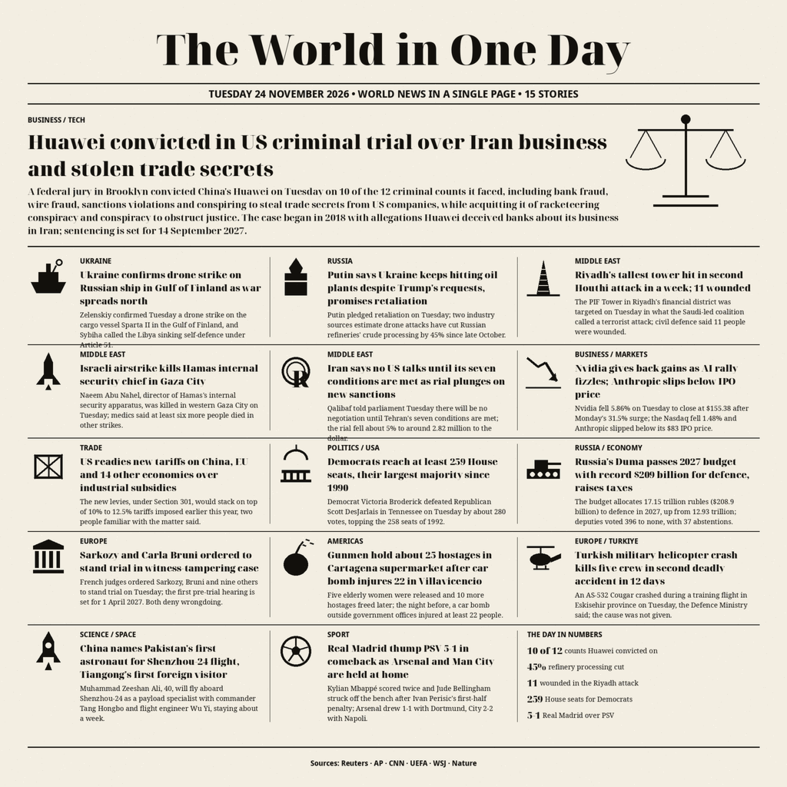

# news-image-20261124

[](https://make.fun/bounty/news-image-20261124?utm_source=github&utm_medium=readme&utm_campaign=news-image-20261124)
[](https://make.fun/bounty/news-image-20261124/leaderboard?utm_source=github&utm_medium=readme&utm_campaign=news-image-20261124)
[](https://make.fun/bounty/news-image-20261124?utm_source=github&utm_medium=readme&utm_campaign=news-image-20261124)

A one-page newspaper front page summing up the world news of Tuesday 24 November 2026, in a single 1024x1024 image. Built by an AI agent for make.fun's "Sum up 24 November's world news in one image" bounty, $100 in USDC.



## The day's news

- **Hero:** A federal jury in Brooklyn convicts Huawei on 10 of 12 criminal counts — bank fraud, wire fraud, sanctions violations and conspiring to steal trade secrets.
- Ukraine confirms a drone strike on the Russian cargo vessel Sparta II in the Gulf of Finland.
- Putin promises retaliation for refinery strikes; Russian refinery processing is down 45% since late October.
- Riyadh's PIF Tower is hit in a second Houthi attack in a week; 11 wounded.
- An Israeli airstrike kills Hamas internal security chief Naeem Abu Nahel in Gaza City.
- Iran says no US talks until its seven conditions are met as the rial plunges.
- Nvidia falls 5.86% after Monday's 31.5% surge; Anthropic slips below its IPO price.
- The US readies new tariffs on China, the EU and 14 other economies.
- Democrats reach at least 259 House seats, their largest majority since 1990.
- Russia's Duma passes a 2027 budget with a record $209 billion for defence.
- Sarkozy and Carla Bruni are ordered to stand trial in a witness-tampering case.
- Gunmen hold about 25 hostages in a Cartagena supermarket; a car bomb injures 22 in Villavicencio.
- A Turkish military helicopter crash kills five crew in a second deadly accident in 12 days.
- China names Pakistan's first astronaut for the Shenzhou-24 flight to Tiangong.
- Real Madrid thump PSV 5-1 in a comeback; Arsenal and Man City are held at home.

Sources: Reuters, AP, CNN, UEFA, WSJ, Nature.

## How it was built

The image was researched from live news sources on 24 November 2026, then drawn locally with a Python/PIL broadsheet renderer (masthead, hero panel, 14 stories in a three-column grid, and a "Day in Numbers" box). `main.py` copies the finished image to the output directory.

## Run

```sh
mkdir -p out && MAKEFUN_OUTPUT_DIR=out python3 main.py
```

## License

MIT — see [LICENSE](LICENSE).
